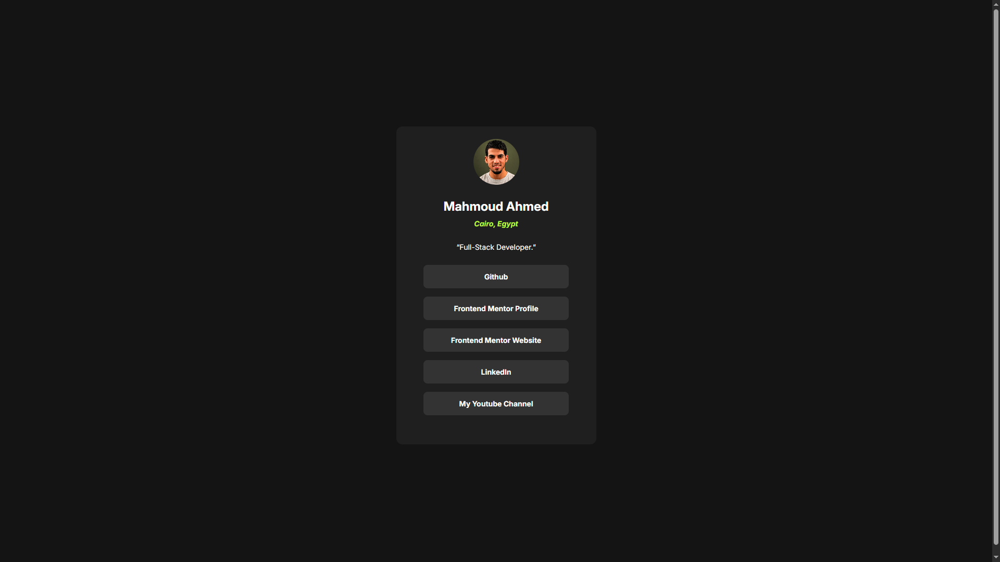

# Frontend Mentor - Social links profile solution

This is a solution to the [Social links profile challenge on Frontend Mentor](https://www.frontendmentor.io/challenges/social-links-profile-UG32l9m6dQ). Frontend Mentor challenges help you improve your coding skills by building realistic projects. 

## Table of contents

- [Overview](#overview)
  - [The challenge](#the-challenge)
  - [Screenshot](#screenshot)
  - [Links](#links) 
  - [Built with](#built-with)
  - [What I learned](#what-i-learned)
  - [Continued development](#continued-development)
  - [Useful resources](#useful-resources)
  - [AI Collaboration](#ai-collaboration)
- [Author](#author)
- [Acknowledgments](#acknowledgments)

**Note: Delete this note and update the table of contents based on what sections you keep.**

## Overview
it's a simple social profile card

### The challenge

Users should be able to:

- See hover and focus states for all interactive elements on the page

### Screenshot

 
### Links

- Solution URL: [Add solution URL here](https://github.com/promahmoud219/social-links-profile)
- Live Site URL: [Add live site URL here](https://promahmoud219.github.io/social-links-profile/)

### Built with

- Semantic HTML5 markup 
- Flexbox 
- Mobile-first workflow
 
### What I learned

During the development and refactoring of this project, several important best practices, CSS concepts, and architectural decisions were applied:

### 1. BEM (Block Element Modifier) Methodology
- Adopted the **BEM** naming convention (`block`, `block__element`, and `block__element--modifier`) for all CSS classes to ensure high maintainability, low CSS specificity, and a clean component-based structure.

### 2. Flat Component Structure & Layout Harmony
- Opted for a **flat structural layout** (direct children inside the card container) rather than forcing artificial inner wrapper sections (like redundant `header` or `body` divs). 
- This choice allowed direct utilization of **Flexbox** and **Gap**, ensuring that spacing between the profile picture, name/location, bio, and link list is uniform, perfectly balanced, and matches the **Figma** design with absolute precision.

### 3. Responsive Sizing with `max-width`
- Utilized `max-width` alongside percentage-based widths (`width: 100%`). This ensures the profile card and link containers remain fluid and responsive on mobile screens while preventing excessive stretching on large desktop displays.

### 4. Mastering `box-sizing: border-box`
- Overcame layout overflow issues caused by the default `content-box` model, where adding `padding` on top of `width: 100%` forces elements to exceed their container's boundaries. 
- Applying `box-sizing: border-box` ensures padding is calculated *inside* the element's total width, maintaining strict layout containment.

### 5. Text Centering & Display Strategies
- Explored how to center text inside block-level elements using `display: block` combined with `text-align: center` and `box-sizing: border-box`, versus using `display: flex` with `justify-content` and `align-items` for seamless vertical and horizontal alignment.

### 6. Accessibility (a11y) & Semantic HTML
- Evaluated the semantic use of the `<nav>` tag: avoided redundant navigation landmarks if a global header or sidebar navigation already exists, keeping the accessibility tree clean and uncluttered for screen reader users.

  

### AI Collaboration

- I used gemini and chatGPT

## Author 
- Frontend Mentor - [@promahmoud219](https://www.frontendmentor.io/profile/promahmoud219) 
 
